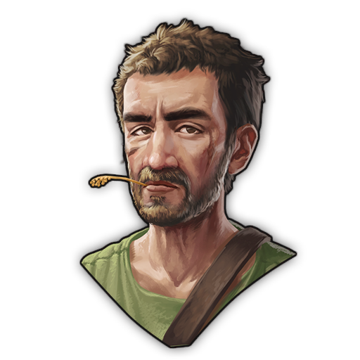
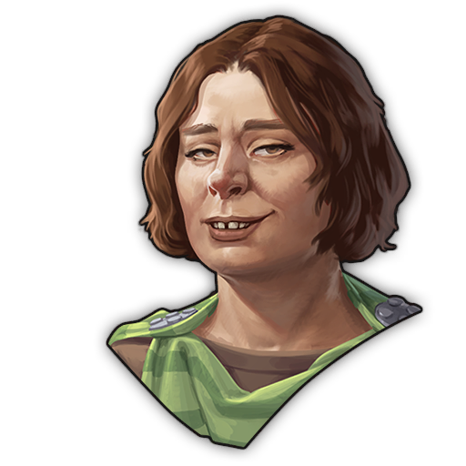
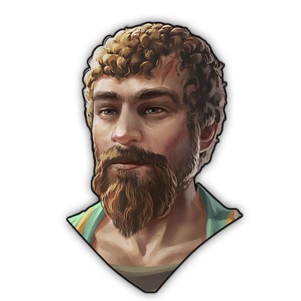
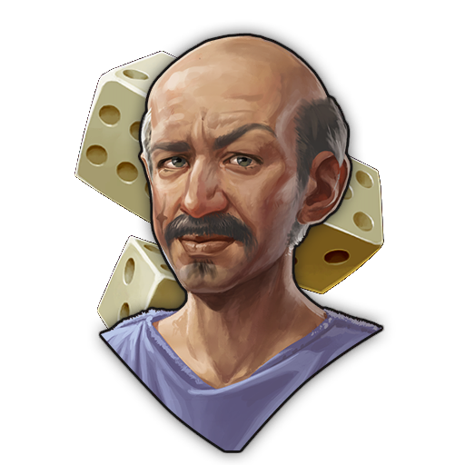
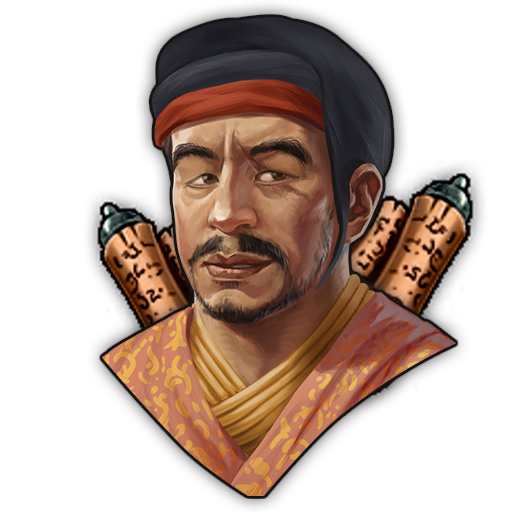
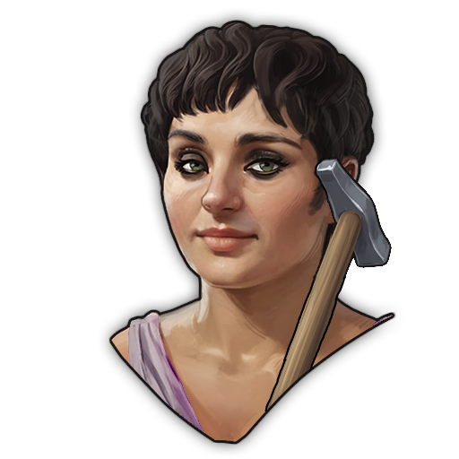
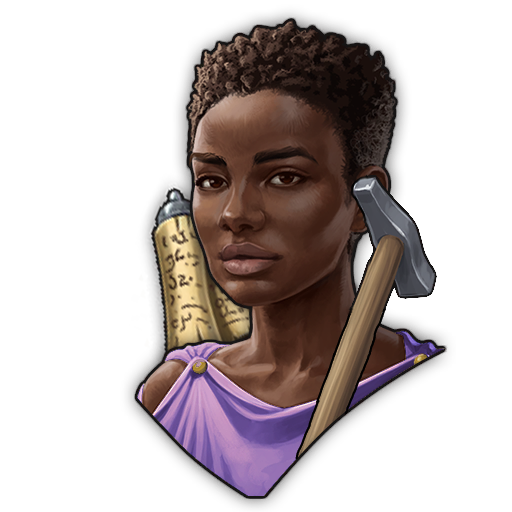
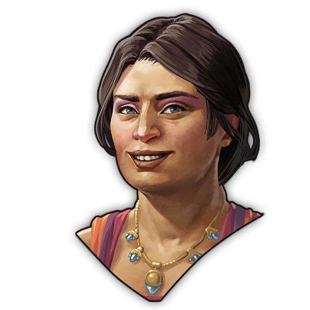

# Public Services Specialist Pack - Mod
This mod adds Specialists with focus on variuos Public Services / Wonders into Anno 117. This Mod is part as a submod of "Extended Specialists Mod".
***

### Specialists Overview (AI Generated - might still contain Issues)
***
### Common Specialists
| Image Preview | GUID | Internal Name | Itemname | Description | Targets | Base Effects |
| :---: | :---: | :---: | :---: | :---: | :---: | :---: |
|  | 1600000005 | Specialist AE-Bard-Belief-C | Unwanted Bard | "Here's to a little serenade"... "NOoooo! By Cernunnos stop him!" | Bardic Hearth | Area Effect:  • +0.5 Belief |
|  | 1600000013 | Specialist AE-Market-Belief-C | Religious Merchant | Offers a variety of different religious items for any deity. | Marketplace | Area Effect:  • +0.5 Belief |
|  | 1600000021 | Specialist AE-PSRegioT1-Money-C | Tavern Guard | Makes sure every denarii is payed. | Tavern, Bardic Hearth | Area Effect:  • +0.5 Money |
***
### Rare Specialists
| Image Preview | GUID | Internal Name | Itemname | Description | Targets | Base Effects |
| :---: | :---: | :---: | :---: | :---: | :---: | :---: |
|  | 1600000166 | Specialist AE-CSGrove-Ritual-R | Pagan Ritualist | Executes celtic pagan rituals to the Romans' detriment. | Sacred Grove | Area Effect: • -1 Prestige • +1.5 Belief • +0.5 Knowledge |
|  | 1600000178 | Specialist AE-Gramma-R | Motivated Teacher | Investing into the future results in investing into Knowledge. | Grammaticus | Area Effect: • +1 Knowledge |
|  | 1600000174 | Specialist AE-Gamble-R | Gambling Debt Collector | Allows high-risk bets just as an excuse to visit your home. Or better said his new home. | Gambling House | Area Effect: • -1 Happiness • +2 Money • -0.5 Belief |
|  | 1600000017 | Specialist AE-PSReligionT2-R | Impoverished Priestess | Demonstrates to believers how to thrive without material resources. | Sanctuary, Fanum | Area Effect: • +0.5 Happiness • -1 Money • +1 Belief |
|  | 1600000162 | Specialist AE-Bath-Master-R | Angry Bath Attendent | "By Neptune, don't jump off the edge into the bath!" | Baths | Area Effect: • -0.5 Happiness • +1.5 Health |
|  | 1600000009 | Specialist AE-CBarrow-Gardener-R | Celtic Grave Keeper | Preserves the ancient burial mounds. | Barrow | Area Effect: • +1 Prestige • +1 Health |
|  | 1600000186 | Specialist AE-Theater-Joker-R | Mischievous Actor | Brings nearly everyone to a good laught, except the nobility. | Theaters | Area Effect: • +1 Happiness • -0.5 Prestige |
***
### Epic Specialists
| Image Preview | GUID | Internal Name | Itemname | Description | Targets | Base Effects |
| :---: | :---: | :---: | :---: | :---: | :---: | :---: |
|  | 1600000076 | Specialist AE-TempleCernunnos-E | Elder Druid of Cernunnos | Knows the old celtic virtues of the deity Cernunnos. | Temple | Area Effect:  • +0.8 Belief • +0.8 Health |
|  | 1600000080 | Specialist AE-TempleEpona-E | Elder Druid of Epona | Knows the old celtic virtues of the deity Epona. | Temple | Area Effect: • +0.8 Population • +0.8 Happiness |
|  | 1600000068 | Specialist AE-TempleMars-E | Priestess of Mars | Highly devoted and preaches the roman virtues of the deity Mars. | Temple | Area Effect: • +0.8 Population • +0.8 Prestige |
|  | 1600000084 | Specialist AE-TempleMercury-E | Priestess of Mercury | Highly devoted and preaches the roman virtues of the deity Mercury. | Temple | Area Effect: • +1.6 Money |
|  | 1600000088 | Specialist AE-TempleMinerva-E | Priestess of Minerva | Highly devoted and preaches the roman virtues of the deity Minerva. | Temple | Area Effect: • +0.8 Prestige • +0.8 Knowledge |
|  | 1600000092 | Specialist AE-TempleNeptune-E | Priestess of Neptune | Highly devoted and preaches the roman virtues of the deity Neptune. | Temple | Area Effect: • +0.8 Money • +0.8 FireSafety |
|  | 1600000072 | Specialist AE-TempleCeres-E | Priestess of Ceres | Highly devoted and preaches the roman virtues of the deity Ceres. | Temple | Area Effect: • +0.8 Population • +0.8 Health |
|  | 1600000048 | Specialist AE-CTHall-Story-E | Vidumaros, Celtic Traditionalist | Keeps celtic tradition alive through tellings of former generations. | Alder Council | Area Effect: • +1 Happiness • +1 Prestige • +0.5 Knowledge |
|  | 1600000056 | Specialist AE-Gamble-Legal-E | Probus, Honest Gambler | Checks every dice with a keen eye, so only fate decides your chances. | Gambling House | Area Effect: • +1 Happiness • +0.5 Prestige |
|  | 1600000060 | Specialist AE-Lib-Know-E | Julia Archivola, the Living Bibliothēcaria | Expands the library up to the ceiling with knowledge from distant lands. Let's hope there's no fire nearby. | Library | Area Effect: • +1 Prestige • +2 Knowledge • -1 Fire Safety |
|  | 1600000064 | Specialist AE-Lib-Pop-E | Varius Flexus, Human Biologist | Traveled to many coasts to observe and study all different types of human bodies. One of the first writers of scrolls on the flexibilty of human anatomy. | Library | Area Effect: • +0.5 Population • +1 Health |
|  | 1600000096 | Specialist AE-Theater-Hag-E | Ethelia, Hag Actress | Plays the role of a ugly hag, who loves to collect in other peoples eyeballs. Always open for a deal. In her favor of course. | Theaters | Area Effect: • +0.25 Happiness • +1 Belief • +0.25 Health |
|  | 1600000220 | Specialist AE-WonderT3-Counter-E | Aurelia Ordinata, Census Delegate | "117 Citizens... 1404 Citizens... 1503 Citizens... 1602 Citizens... 1800 Citizens... 2070 Citizens... 2205 Citizens..." | Forums and Alder Council | Area Effect: • +2 Population • -1 Happiness • -1 Fire Safety • -1 Health |
|  | 1600000230 | Specialist AE-Gramma-Prod-E | Fabia Novella, Experimental Crafter | Teaches experimental craftmanship which causes citizens to stop trusting the gods. | Grammaticus | Area Effect: • -1 Belief   • All ProductionBuildings: Additional Product every 5 Cycle |
|  | 1600000234 | Specialist AE-CSGrove-Pop-E | Nemetona Damona, Fertility Rites Druid | Her divine mission is to ensure that children are successfully brought into this turbulent and harsh world. | Sacred Grove | Area Effect: • +1 Population   • +0.25 Belief   • +0.25 Health   |
|  | 1600000244 | Specialist AE-CBarrow-Raider-E | Quintus Merula, Raider of the Grove | Raiding old celtic barrows can offer many riches. This fellow don't care if he'll anger their gods and the locals. | Barrow | BuildingBuff: • -100% Maintenance   Area Effect: • -2 Happiness   • +4 Money   • +3 Prestige   • -2 Belief   • -1 Health   |

***
### Legendary Specialists
| Image Preview | GUID | Internal Name | Itemname | Description | Targets | Base Effects | Boosted Effects | Boost Condition |
| :---: | :---: | :---: | :---: | :---: | :---: | :---: | :---: | :---: |
|  | 1600000216 | Specialist AE-Forum-Prod-L | Cornelia Regula Rectrix, Strict Economist | Triggers the heart of roman Craftsmanship and Trade.   Hint I: Productivity applies to All Production Buildings in Street Range.  Hint II: In Albion, the temple also counts as a forum. | Forums, (Albion: Temple) | • +15% Productivity for all Production Buildings in Range | Area Effect: •+1 Money •+1 Prestige  • +25% Productivity for all Prouction Buildings in Range | Own more than 42 Production buildings |
|  | 1600000148 | Specialist AE-Theater-Happy-L | Marcia Favor, the Beloved Crowdfavorite | “What an exquisite performance!” “What an amazing talent!” “When I grow up, I want to be just like her!” | Theaters | Area Effect: • +1.6 Happiness • +0.8 Prestige | Area Effect: • +2 Happiness • +1 Prestige • +1 Knowledge | Population >= 15000 |
